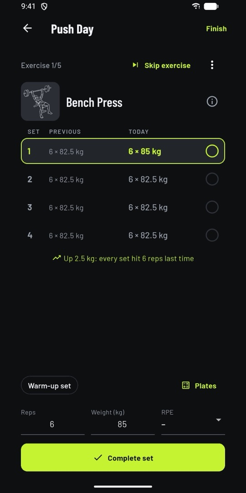
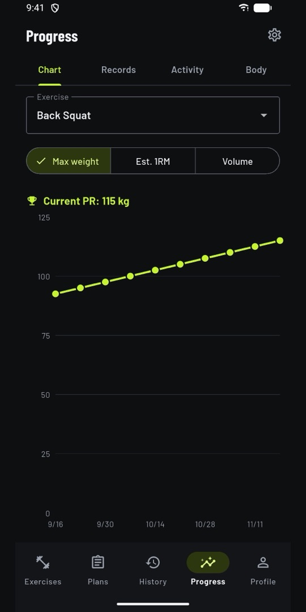
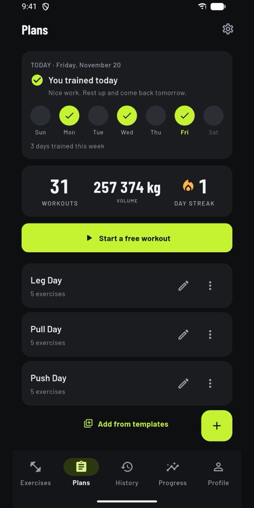

# GymFlow website

Source of **[khoatn1993.github.io](https://khoatn1993.github.io/)**, the website for
[GymFlow](https://play.google.com/store/apps/details?id=com.fitness.personal), a gym workout
log and tracker for Android.

GymFlow lets you plan workouts, log every set and see your progress. There is no account, and
your workout data stays on your phone.

<p align="center">
  
  
  
</p>

## Pages

| URL | File | What it is |
|---|---|---|
| [`/`](https://khoatn1993.github.io/) | [index.html](index.html) | Landing page: features, screenshots, Free vs Premium, FAQ |
| [`/privacy.html`](https://khoatn1993.github.io/privacy.html) | [privacy.html](privacy.html) | Privacy policy, the one linked from the Play listing |
| [`/terms.html`](https://khoatn1993.github.io/terms.html) | [terms.html](terms.html) | Terms of use |
| [`/app`](https://khoatn1993.github.io/app) | [app/index.html](app/index.html) | Short link that redirects to the Google Play listing |
| [`/app-ads.txt`](https://khoatn1993.github.io/app-ads.txt) | [app-ads.txt](app-ads.txt) | Authorized ad sellers for AdMob ([IAB app-ads.txt](https://iabtechlab.com/ads-txt/)) |

Every page is in English and Vietnamese. On the landing page, the EN / VI switch picks the
language. It starts from `?lang=vi`, then the visitor's last choice, then the browser language.
The policy pages have both languages on one page, with the Vietnamese text under `#vi`.

## How it is built

Plain static HTML and CSS. There is no build step, no framework and no JavaScript dependency.

- [index.html](index.html) carries its own styles and the small language-switch script inline.
- [style.css](style.css) styles the privacy and terms pages.
- [img/](img/) holds the app icon, the favicon, the social preview image (`og.jpg`) and the
  app screenshots.
- Fonts are Barlow and Barlow Condensed from Google Fonts, the same fonts the app uses.

## Run it locally

Any static file server works:

```bash
python3 -m http.server 8000
# open http://localhost:8000
```

## Deploy

GitHub Pages serves the default branch from the repository root. Push to it and the site
updates within a minute or two.

Keep these URLs stable. The Play Console and AdMob point at them:

- `privacy.html` is the privacy policy URL in the Play listing.
- `app-ads.txt` must stay at the root of the developer website domain.

## Contact

GymFlow is published by Khoa Apps Studio. For support, email
[gymflow.app.help@gmail.com](mailto:gymflow.app.help@gmail.com).
